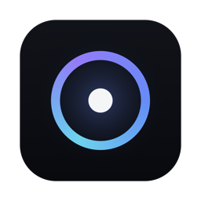
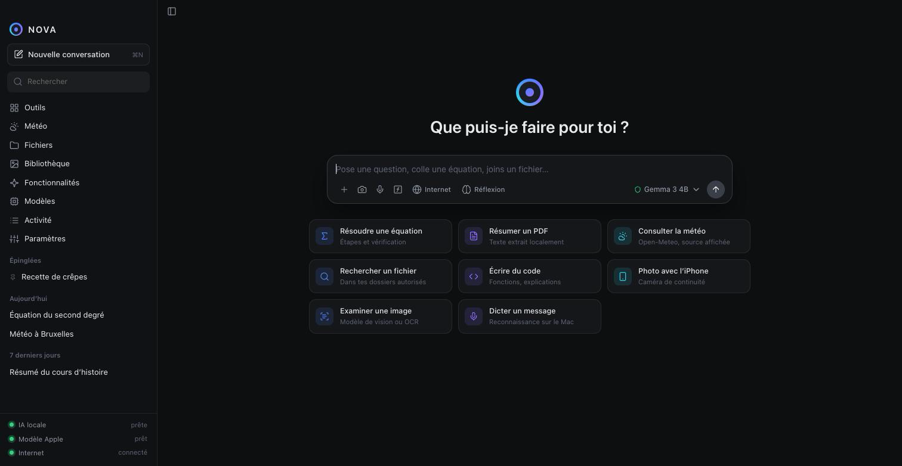

<div align="center">



# NOVA

**A free, private AI assistant that runs entirely on your computer.**

Chat, solve maths, read your documents, understand images, check the weather, find your files and act on your computer — with your permission, and without sending your data anywhere.

[](https://github.com/Nolek0/nova/releases/latest)
[](https://github.com/Nolek0/nova/actions/workflows/ci.yml)


[**Download**](#download) · [Features](#features) · [Models](docs/MODELS.md) · [Privacy](docs/PRIVACY.md) · [Build from source](docs/BUILDING.md) · [Architecture](docs/ARCHITECTURE.md)

</div>

---

## Why NOVA?

| | |
|---|---|
| 🔒 **Private by design** | Conversations, settings, memory and models stay on your machine. Nothing leaves it unless you ask (weather, Wikipedia mode, model downloads) — and those answers are clearly labelled. |
| 💸 **Free, no account** | No subscription, no sign-up, no API key. Every model NOVA offers is open and free (Apache 2.0). |
| ⚡ **Fast** | Runs on your GPU through [llama.cpp](https://github.com/ggml-org/llama.cpp). A "hello" gets its first word in about 0.2 s on an Apple M-series Mac. |
| 🧰 **More than a chatbot** | Built-in tools answer instantly and offline: maths with steps, unit conversions, timers, weather, file search, system actions. |
| 🖥️ **Cross-platform** | One app for macOS and Windows, built with [Tauri](https://tauri.app) (≈ 13 MB). |

## Download

👉 **[Get the latest version](https://github.com/Nolek0/nova/releases/latest)**

| Platform | File | Requirements |
|---|---|---|
| macOS (Apple Silicon) | `NOVA-x.y.z-mac-apple-silicon.dmg` | M1 or newer, macOS 13+ |
| Windows | `NOVA_x.y.z_x64-setup.exe` | Windows 10/11, 64-bit |

NOVA updates itself: when a new release is published here, the app offers to install it.

<details>
<summary><b>macOS: “Apple could not verify NOVA”</b></summary>

NOVA is a free app distributed outside the App Store, so macOS asks for confirmation the first time:

1. Drag **NOVA** into **Applications**, then open it.
2. If macOS blocks it, open **System Settings → Privacy & Security**, scroll down and click **Open Anyway**.
3. If macOS says the app is “damaged”, run once in Terminal:
   ```bash
   xattr -dr com.apple.quarantine /Applications/NOVA.app
   ```
</details>

<details>
<summary><b>Windows: “Windows protected your PC”</b></summary>

Click **More info → Run anyway**. The installer is not code-signed with a paid certificate yet; it is built publicly by [GitHub Actions](https://github.com/Nolek0/nova/actions) from this repository.
</details>

## Features

### 💬 Conversation
- Streaming answers with Markdown, syntax-highlighted code, tables and copy buttons
- Edit & resend, regenerate, stop, read aloud (system voices)
- Full-text search across your history, pinned conversations, export to JSON
- **Fast mode** by default; **Deep thinking** toggle for hard questions (reasoning stays collapsed)
- **Memory** you control: NOVA only remembers what you explicitly add

### 🧠 Local AI
- One-click install of the llama.cpp engine and of open models (Gemma 4, Qwen 3.6 / 3.8, gpt-oss) — **you decide what to download**, with a progress bar, speed, ETA, cancel and resume
- NOVA recommends the best model for your RAM
- Model pre-loading for instant first answers; automatic engine recovery
- Uses [Ollama](https://ollama.com) models too if you already have it
- macOS 26+: Apple's on-device model as a lightweight option

### 🖼️ Images & documents
- Drop, paste or attach images, PDFs, text and code files
- Images are analysed by a local vision model (NOVA switches to one automatically)
- Text extraction from PDFs, OCR on macOS
- Take a photo with your **iPhone** (Continuity Camera, macOS) or your webcam

### 🛠️ Built-in tools (instant, offline)
- **Maths**: calculator, equations with steps and verification, linear systems, derivatives, function plots, statistics, probabilities, matrices
- **Conversions**: 12 quantities, 80+ units
- **Weather**: current, hourly and 7-day forecast ([Open-Meteo](https://open-meteo.com)); offline it shows the last known data, clearly marked
- **Files**: search by name and content, only in folders you allow
- **Actions**: open apps, websites and files, create notes — always shown first and run only after you click **Allow**
- **Wikipedia mode**: answers backed by cited sources

### 👩‍💻 Nova Code (optional)
- A separate **Code** workspace, enabled in Settings: open a project, browse files, ask Nova Code to explain or change code (`@path` to include a file)
- Every proposed file is shown as a **diff** and written only when you click **Apply** — with an automatic backup of the previous version
- macOS: a **notch island** — hover the MacBook notch to see Nova Code's status and send a request

### 🌍 Languages
- Interface in the **system language** by default: English, Français, Español, Português, Deutsch, Italiano, Nederlands, Kiswahili, Lingála, Kreyòl ayisyen
- Answers in ~140 languages, including creoles, Lingala, Kikongo, Tshiluba and Wolof — or any language you type

### 🍎 macOS extras
- **Menu-bar mini chat**: click the NOVA icon, ask, read the answer in a floating panel — no app switching
- Native menu bar, dictation with on-device speech recognition

## Screenshots

<p align="center"></p>

## How it works

```
┌──────────────── UI (HTML/CSS/JS, no build step) ────────────────┐
│ sidebar · chat · tools · weather · files · models · settings    │
└───────────────────────────┬──────────────────────────────────────┘
                            │ Tauri commands & channels
┌───────────────────────────▼──────────────────────────────────────┐
│ Rust core: router · tools · SQLite (FTS5) · llama.cpp manager   │
│            weather · files · actions · updater                   │
└───────┬───────────────────────┬──────────────────────┬───────────┘
        │                       │                      │
  llama-server (local)    Ollama (optional)    Swift helper (macOS):
  Gemma 4 · Qwen · gpt-oss                     Apple model, OCR,
                                               Continuity Camera, dictation
```

Every message first goes through the **router**: if a local tool can answer (maths, conversion, weather, file search, action…), it answers instantly. Otherwise the selected language model takes over. See [docs/ARCHITECTURE.md](docs/ARCHITECTURE.md).

## Repository layout

| Path | What |
|---|---|
| [`app/src-tauri`](app/src-tauri) | Rust core (Tauri 2): commands, router, tools, storage, engine manager |
| [`app/ui`](app/ui) | User interface (vanilla JS modules, vendored libraries) |
| [`apple`](apple) | Swift package: macOS helper (Apple model, OCR, camera, dictation) |
| [`nova1`](nova1) | **Nova 1**, NOVA's own command-understanding model, trained from scratch |
| [`scripts`](scripts) | Build, DMG and release scripts |
| [`docs`](docs) | Documentation |

## Roadmap

- [x] Interface in many languages (system language by default)
- [ ] **Nova 1** integrated as the instant first layer for everyday commands
- [x] **Nova Code** — a dedicated coding workspace, with an optional notch “island” on macOS
- [ ] More interface languages (contributions welcome: `app/ui/js/locales/`)
- [ ] Dictation on Windows (local Whisper)
- [ ] Agent mode: multi-step computer control, every action approved

## Contributing

Issues and pull requests are welcome — see [CONTRIBUTING.md](CONTRIBUTING.md). Please report security problems privately as described in [SECURITY.md](SECURITY.md).

## License

NOVA is released under the [MIT License](LICENSE).
Models are downloaded from their official sources and keep their own licenses (Gemma 4, Qwen and gpt-oss are Apache 2.0). llama.cpp is MIT.
